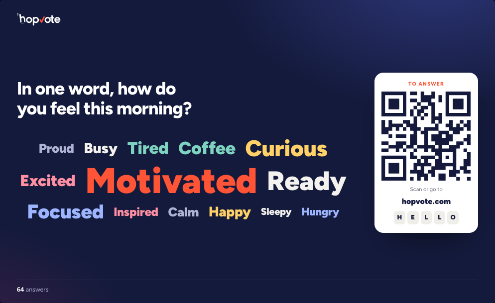

  <picture>
    <source media="(prefers-color-scheme: dark)" srcset="brand/hopvote-logo-dark-bg.svg">
    
  </picture>

<h3 align="center">Live polls, quizzes and Q&A by QR code</h3>

  Your audience answers from their phones. The results move live on the big screen.
   
   
  <a href="#quick-start">Quick start</a>
  ·
  <a href="#deploy-to-cloudflare">Deploy</a>
  ·
  <a href="#configuration">Configuration</a>
  ·
  <a href="CONTRIBUTING.md">Contributing</a>
  ·
  <a href="SECURITY.md">Security</a>

  
  
  

  

## About

Hopvote turns a talk, a class or a meeting into a conversation. Show a QR code: people answer from their phones in a few seconds, with no app and no account, and the results appear live on the big screen.

This repository is the Hopvote app, free software under the AGPL-3.0. Run it on your own machine or on your own Cloudflare account: every feature is included. If you would rather not host it yourself, [hopvote.com](https://hopvote.com) runs it for you.

## Features

- **20 question types:** single and multiple choice, rating, rating scale, ranking, prioritize (100 points to share), word cloud, open text, audience Q&A with upvotes, spin the wheel, quiz with timer and leaderboard, guess a number, right order, fill in the blanks, match pairs, find on the image, slide, link to scan, video or audio, timer, and contact details (with consent).
- **Join by QR code:** participants scan the QR code or type a 5-character code. No app, no account.
- **Phones in 35 languages:** each participant reads the questions in their own language. Audience questions and open answers are translated too, on phones and on the big screen.
- **Live results** on the big screen, updated as the answers come in.
- **Quiz games:** a leaderboard after each question, after each round or at the end, and timed games with a 3, 2, 1 count-in.
- **Topic rounds:** 2 to 8 topics, each with its own questions. A wheel or a room vote picks the next topic.
- **AI writing help:** write a presentation from a short brief, improve a whole presentation, or reword one question.
- **Your brand on every screen:** logo, colors, fonts and background, saved as brand kits.
- **Teams:** up to 3 presenters open, edit and present each other's presentations.
- **CSV export** of results and contact details, and **community templates** to start from.

## Quick start

You need [Node.js](https://nodejs.org) 22.18 or later.

~~~sh
git clone https://github.com/Hopvote/hopvote.git
cd hopvote
npm install
npm run setup
npm run dev
~~~

Open http://localhost:5180, create an account and make your first presentation. To try it with phones on the same Wi-Fi, set `VITE_PUBLIC_URL` in `.env` to your computer's network address (like `http://192.168.1.20:5180`), restart `npm run dev` and present from http://localhost:5180: the QR code then points to your computer.

`npm run setup` makes your settings files from the examples (`wrangler.jsonc`, `.dev.vars`, `.env`) and creates the database on your machine. Run it again after each update: it keeps your files and adds the new tables.

Everything runs on your machine without a Cloudflare account, except AI writing help and translations: Workers AI only runs on Cloudflare. Until then, the AI buttons answer that the AI is busy, and phones show the questions as written. To use them while developing, run `npx wrangler login`, then empty the line `HOPVOTE_LOCAL_ONLY=1` in `.env`.

Without an email service, accounts open without email confirmation, and the links of other emails (password reset, team invitations) are printed in the dev server's log: a team invitation then says it could not send the email, open the printed link instead.

## Deploy to Cloudflare

1. `npx wrangler login`
2. `npx wrangler d1 create hopvote-db --binding DB`: Wrangler writes the new database id into `wrangler.jsonc`.
3. Set `PUBLIC_URL` in `wrangler.jsonc`: your `workers.dev` address, or your own domain (see `routes` in the same file).
4. `npm run deploy`: it checks the settings, builds, applies the database migrations and deploys.

The Worker serves the app, the API and the live rooms (Durable Objects). Check Cloudflare's limits for Workers, Durable Objects and D1 against the size of your events.

## Configuration

Every feature below is optional: without its setting, it turns itself off.

| Feature | Without it | To turn it on |
| --- | --- | --- |
| Emails: sign-up confirmation, password reset, team invitations | Accounts open right away; the links go to the logs. | A [Resend](https://resend.com) account: the `RESEND_API_KEY` secret, `MAIL_FROM` on a domain verified in Resend, then `MAIL_READY` set to "1". |
| Sign in with Google | The button is hidden. | `GOOGLE_CLIENT_ID`: a "Web application" OAuth client id from the Google Cloud console, with `https://your-domain/auth/google` (and `http://localhost:5180/auth/google` to test locally) as an authorized redirect URI. No client secret is needed. |
| AI writing help and translations | Off on your machine while `HOPVOTE_LOCAL_ONLY=1` is set. | On once deployed, with Workers AI. |
| Contact and source code links in the help | Hidden. | `VITE_CONTACT_EMAIL` and `VITE_SOURCE_URL` in `.env`. |

The worker reads its settings from the `vars` of `wrangler.jsonc` and its secrets from `npx wrangler secret put NAME`; on your machine, `.dev.vars` overrides both.

### Limits

Each limit is a constant in the code, easy to change:

- A presentation: 50 questions and 3,000 participants (`worker/limits.ts`).
- A team: the owner and 2 people they invite (`TEAM_SEATS` in `worker/team.ts`).
- AI: 100 writing help requests per account and per day (`worker/ai.ts`), within a daily budget for the whole server (`worker/ai-budget.ts`).
- Images: 300 per account, 100 MB a day and 300 MB in all (`worker/index.ts`).
- Emails: caps per address, per network and per day (`MAIL_DAY` in `worker/auth.ts`), set under the 100 emails a day of Resend's free plan.

### Before you open your copy to others

- Write your own privacy policy and terms, and link them from your site: this repository has none.
- Use your own name and logo (see [TRADEMARKS.md](TRADEMARKS.md)). The name shows in `index.html`, `public/site.webmanifest`, the icons in `public/`, the logo in `src/ui.tsx`, the emails (`worker/mail.ts`, `worker/auth.ts`, `worker/team.ts`) and some texts of `src/i18n/`.
- If you change the code, the AGPL asks you to offer your source code to your users: set `VITE_SOURCE_URL` and the help page links to it.

## Tech stack

- **Front:** React 19, TypeScript and Vite.
- **Back:** one [Cloudflare Worker](https://developers.cloudflare.com/workers/) for the API, and a [Durable Object](https://developers.cloudflare.com/durable-objects/) per live presentation, which holds the room and its WebSocket connections.
- **Data:** [Cloudflare D1](https://developers.cloudflare.com/d1/) (SQLite), with the schema in `migrations/`.
- **AI:** [Workers AI](https://developers.cloudflare.com/workers-ai/) for writing help and translations.
- **Email:** [Resend](https://resend.com), optional.

## Development

- `npm run check`: type check, CSS check and translations check. Run it before every pull request.
- `npm test`: the API tests, against the dev server. Set `MAIL_DEV=1` in `.dev.vars`, start `npm run dev` in another terminal, then run it. They create and delete throwaway local accounts. The CI runs them on every pull request.
- `npm run test:browser`: screen layout, branding and language checks with Chrome, against the dev server with `MAIL_DEV=1` like `npm test` (set `CHROME_PATH` if Chrome is not found).
- `npm run previews`: the example pictures of the question menu, made with Chrome while the dev server runs.
- With Workers AI (dev server with `MAIL_DEV=1` and the `HOPVOTE_LOCAL_ONLY` line emptied): `node scripts/ai-kinds-test.mjs --live` and `node scripts/ai-budget-test.mjs`.

## Project structure

~~~text
src/          The app (React): sign-in, builder, presenter screen, phone pages, settings
worker/       The Cloudflare Worker: API, accounts, AI, email; room.ts is the Durable Object of a live presentation
migrations/   The D1 database schema
public/       Static files
scripts/      Setup, checks and tests
brand/        Hopvote logos (not under the AGPL, see TRADEMARKS.md)
docs/         Images of this readme
~~~

## Contributing

Bug reports and pull requests are welcome. Please read [CONTRIBUTING.md](CONTRIBUTING.md) first, and run `npm run check` before you open a pull request.

## Security

Please do not open a public issue for a security problem. Report it privately as described in [SECURITY.md](SECURITY.md).

## License

Copyright (C) 2026 the Hopvote authors.

Hopvote is free software under the [GNU Affero General Public License v3.0](LICENSE) (AGPL-3.0-only). Third-party files and their own licenses are listed in [NOTICE.md](NOTICE.md).

The Hopvote name and logo are not covered by the AGPL. A fork or a copy run for other people must use its own name and logo. See [TRADEMARKS.md](TRADEMARKS.md).
